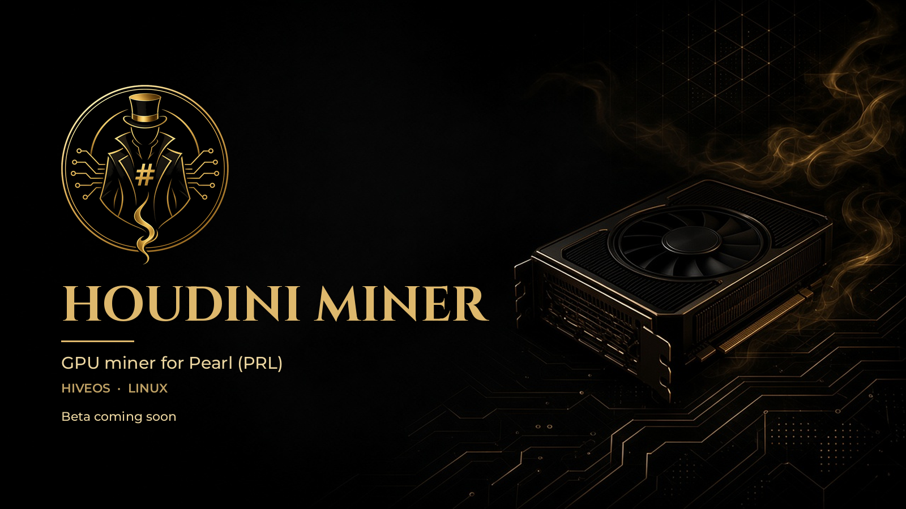

# Houdini Miner

<!-- Place the official horizontal logo at assets/logo.png
     (source file: logo_horizontal.png). -->
<p align="center">
  
</p>

Houdini Miner is a GPU miner for **Pearl (PRL)**. It is distributed as a Linux x86-64 binary and as a HiveOS custom miner package. The mining algorithm is PearlHash.

This repository is intended to host documentation and official release packages.

## Status

**Beta.** This software is under active development. Behaviour, package layout, and performance may change between builds.

<!-- TODO: set the official public version name (the inspected package uses 61d92ca; the binary reports "houdini 1.0 (Pearl)"). -->

## Features

- Pearl (PRL) mining on NVIDIA GPUs
- HiveOS custom miner install, with pool, wallet, and worker taken from the flight sheet
- Standalone Linux use via environment variables or a short command line
- A shipped low-VRAM profile (about 4 GB measured)
- A fixed 1% developer fee, compiled into the binary

## Requirements

- A 64-bit Linux system (HiveOS or a general Linux host)
- glibc **2.34** or newer
- An NVIDIA GPU and a working NVIDIA driver that provides `libcuda.so.1`
- `libz` (`libz.so.1`)

The miner binary was built with the **CUDA 13.0** toolkit (V13.0.88). The CUDA runtime is linked statically, so the CUDA toolkit itself does not need to be installed on the rig. A driver compatible with that runtime is required.

The binary includes kernels for NVIDIA architectures **sm_80**, **sm_86**, **sm_89**, **sm_90**, and **sm_120a** (Ampere through Blackwell). That does not mean every card in those families has been tested.

<!-- TODO: official minimum NVIDIA driver version (and any other supported or unsupported GPU list). -->

## Download

<!-- TODO: official download URL and release version. There are no GitHub Releases in this repository yet. Do not publish a SHA256 here until it matches a file attached to a release or committed in the repo. -->

Official packages have not been published yet. When a release is available, download it from the [Releases](https://github.com/houdiniminer/HoudiniMiner/releases) page (or from the official URL listed here) and verify its checksum before installing.

## HiveOS installation

Install Houdini Miner as a **custom miner**.

1. In HiveOS, create a flight sheet for Pearl (PRL).
2. Set the miner to **Custom**.
3. Set the **installation URL** to the official package URL (see [Download](#download)).
4. Fill in the custom miner fields as shown below.
5. Apply the flight sheet to the rig.

| Flight sheet field | Variable | What to enter |
| --- | --- | --- |
| Pool URL | `CUSTOM_URL` | Pool address: `host:port` or `stratum+tcp://host:port` |
| Wallet / worker | `CUSTOM_TEMPLATE` | `WALLET.WORKER` |
| Password | `CUSTOM_PASS` | Pool password, or `x` if the pool does not require one |
| Extra config (optional) | `CUSTOM_USER_CONFIG` | Environment assignments, one per line (see [Configuration](#configuration)) |

The HiveOS wrapper normalizes a bare `host:port` value to `stratum+tcp://host:port`. It also accepts `stratum+tcp://` and `stratum+ssl://` URLs, as well as `tcp://`, `ssl://`, and `tls://` prefixes.

The package name in the manifest is `houdini`. The wrapper starts the binary as `./houdini mine` after exporting `PXL_POOL`, `PXL_WALLET`, and `PXL_PASS` from the flight sheet. The shipped low-VRAM profile in `houdini.env` is applied automatically; you do not need to paste it into Extra config.

If `CUSTOM_PASS` is left empty, the wrapper uses `x`.

## Linux usage

The binary is env-driven. The supported `mine` invocations, as reported by the binary, are:

```text
houdini [-d 0,1,2] mine
# or:
houdini mine <host> <port> <wallet[.worker]> [agent]
# or:
PXL_POOL=stratum+tcp://host:port PXL_WALLET=addr[.worker] houdini mine
```

Example:

```bash
# Replace the pool, wallet, and worker with your own values.
export PXL_POOL=stratum+tcp://POOL_HOST:PORT
export PXL_WALLET=YOUR_WALLET.WORKER
export PXL_PASS=x

# Optional: apply the shipped low-VRAM profile
# (HiveOS does this automatically via houdini.env).
set -a
. ./houdini.env
set +a

./houdini mine
```

To limit which GPUs are used, set `CUDA_VISIBLE_DEVICES`, set `PXL_DEVICES`, or pass `-d`. If `CUDA_VISIBLE_DEVICES` is already set, `-d` and `PXL_DEVICES` are ignored.

```bash
export CUDA_VISIBLE_DEVICES=0,1
./houdini mine

# equivalent, when CUDA_VISIBLE_DEVICES is not already set:
./houdini -d 0,1 mine
```

Other command names reported by the binary (`selftest`, `bench`, `jobprep`, `verify-share`, `seedvec`) are developer/diagnostic tools and are not required for normal mining.

## Configuration

Houdini Miner is configured with environment variables, not with miner CLI flags. In HiveOS, optional variables go in the flight sheet **Extra config** field (`CUSTOM_USER_CONFIG`).

Rules used by the HiveOS wrapper:

- One directive per line; `#` starts a comment
- `NAME=value` or `--NAME=value` is exported into the environment
- Bare flags are ignored (the miner does not take them)

Examples that can be placed in Extra config:

```text
CUDA_VISIBLE_DEVICES=0,1
PXL_BUFSETS=2
PXL_DIMWALK_MB=256
PXL_CONNS=8
```

The package already ships a low-VRAM profile in `houdini.env` (about 4 GB measured; the profile comment lists about 250 TH/s on an RTX 5080). HiveOS sources that file on start. Only add Extra config entries when you need to override a default.

## Developer fee

The developer fee is **1%**. It is compiled into the binary, is always on, and cannot be disabled with an environment variable or flight sheet setting.

## Benchmarks

The figures below are **early developer tests**. They were measured on the [HeroMiners](https://herominers.com/) pool and are reported as average TH/s. Results vary with drivers, clocks, power limits, cooling, pool conditions, and miner version. These numbers are not a guarantee of performance.

| GPU | Average TH/s |
| --- | --- |
| RTX 5090 | 419.96 |
| RTX 5080 | 227.5–241.22 |
| RTX 5070 Ti | 199.82 |
| RTX 5070 | 141.66 |
| RTX 5060 Ti | 105.55 |

The RTX 5080 range above is the measured set from those tests. It sits close to, but slightly below, the “~250 TH/s on RTX 5080” note in the shipped `houdini.env` profile comment.

## Verifying the download

After downloading an official package, check its SHA256 checksum against the hash published with that release:

```bash
sha256sum houdini-<version>.tar.gz
```

<!-- TODO: publish the official SHA256 of each release asset here and in the GitHub Release notes. Do not list a hash until it matches a file in this repository or a published release. -->

## Troubleshooting

**`CUSTOM_URL is empty` or `CUSTOM_TEMPLATE is empty`**  
Set the pool URL and `WALLET.WORKER` in the HiveOS flight sheet. Both are required.

**`missing shared libraries` or `libcuda.so.1: cannot open shared object file`**  
Install or repair the NVIDIA driver so that `libcuda.so.1` is visible to the miner. `libz.so.1` must also be present.

**`CUDA driver version is insufficient for CUDA runtime version`**  
The installed NVIDIA driver is too old for this build (the binary was built with CUDA 13.0). Update the driver and try again.

**`wallet is missing` or `invalid wallet`**  
Check that `CUSTOM_TEMPLATE` / `PXL_WALLET` is a valid Pearl wallet, optionally followed by `.worker`.

**HiveOS shows no hashrate**  
Confirm the miner process is running and check `/var/log/miner/custom/houdini.log`. Hashrate lines look like `Device [N] hashRate: … TH/s`.

## Support

- X: [https://x.com/houdiniminer](https://x.com/houdiniminer)
- GitHub: [https://github.com/houdiniminer/HoudiniMiner](https://github.com/houdiniminer/HoudiniMiner)

<!-- TODO: Discord (or other official support channel), plus a preferred place to file issues. -->

## Disclaimer

This software is provided as a **Beta**, without warranties of any kind. Mining involves operational risk, including hardware wear and software defects. Review the software yourself and use it at your own responsibility. Nothing in this document is financial advice, and no hashrate or return is promised.

## License

<!-- TODO: add a license file to the repository and name it here. -->

The license for this project has not been published yet.
